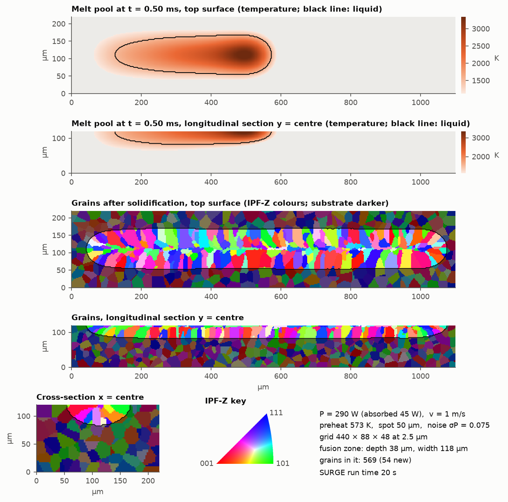

# SURGE demo: one laser track on a GPU

SURGE is a kinetic Monte Carlo model of melting and solidification under a moving laser, for
laser additive manufacturing. It is the `additive/texture` application of
[SPPARKS](https://spparks.github.io) (Sandia National Laboratories), with a GPU port
`additive/texture/kk` built on Kokkos. Its inputs are the laser settings, the scan path, the
starting grain structure and material constants. Its outputs are the melt pool and the grain
structure (grain labels and crystal orientations) it leaves behind.

This folder holds only what you need to build SURGE, run one short track and plot it. The SURGE
source is not copied here: `build.sh` fetches it from
[github.com/trodger-snl/spparks](https://github.com/trodger-snl/spparks/tree/SURGE), branch
`SURGE`, at the tested commit `96fb758`.



*The example track: 290 W at 1 m/s on a 573 K plate of 25 µm grains. Top two panels: the
temperature halfway through the scan, with the liquid region (the melt pool) outlined. Lower
panels: the grains after solidification, coloured by the crystal direction along the build
direction z (IPF-Z key). The substrate is drawn darker, and the black line is the edge of the
region that melted.*

## Files

| File | What it does |
|---|---|
| `environment.yml` | conda environment: CUDA 12.9 toolkit, gcc 13, OpenMPI, CMake, Python with numpy/scipy/matplotlib |
| `build.sh` | fetches SURGE and its Kokkos submodule, detects the GPU, configures and compiles |
| `env.sh` | sourced by `run.sh`: sets `SURGE_BIN` and applies the WSL driver fix |
| `example.toml` | the example track; every tweakable parameter is in it |
| `run_track.py` | config → starting grain structure + SURGE input deck → GPU run → `track.npz` |
| `plot_track.py` | `track.npz` → figure of the melt pool and the grain orientations |
| `run.sh` | runs `run_track.py` and `plot_track.py` |

## Requirements

- Linux x86-64 with an NVIDIA GPU and its driver (`nvidia-smi` must work). The driver must
  support CUDA 12: version 525 or newer, or 570 or newer for Blackwell GPUs (RTX 50xx, B200).
  CUDA 12.9 and Kokkos support Volta (V100) and every newer GPU, which covers the usual cloud
  GPUs (T4, A10G, L4, L40S, A100, H100). This demo was tested on an RTX 5070.
- [conda](https://github.com/conda-forge/miniforge) (Miniforge or Miniconda). The environment
  brings its own CUDA toolkit and compilers, so you need no root access and no system CUDA.
- git, internet access for the first build, and about 2 GB of disk: 1 GB for the environment,
  0.2 GB for the source and build, the rest for conda's package cache.
- About 1 GB of GPU memory for the example. Measured peaks were 0.6–1.4 GB above the idle
  level, and that measure includes other programs on the GPU.

## Quick start

Clone or copy this folder onto the GPU machine, then run these four steps from inside it:

```bash
conda env create -f environment.yml
```

```bash
conda activate surge
```

```bash
bash build.sh
```

```bash
bash run.sh
```

`build.sh` takes about 4 minutes on 16 cores. `run.sh` writes `runs/example/`, and on an RTX 5070
it prints:

```
440 x 88 x 48 voxels, 3549 substrate grains; deck ~/surge_demo/runs/example/in.track (1.1 s)
SURGE finished in 17.8 s
{"depth_um": 37.5, "width_um": 117.5, "melted_voxels": 200527, "grains_in_melt": 569, "new_grains": 54, "liquid_left": 0, "substrate_grains": 3549, "surge_seconds": 17.8}
wrote ~/surge_demo/runs/example/track.npz (19 s in total)
wrote ~/surge_demo/runs/example/track.png
```

Builds with CUDA 12.9 + gcc 13 and with CUDA 13.1 + gcc 15 gave exactly these numbers.

On a headless server, copy the figure back with `scp`, for example
`scp host:surge_demo/runs/example/track.png .`

To run your own settings, copy `example.toml`, edit it and run `bash run.sh my_track.toml`, which
writes `runs/my_track/`. For a parameter sweep, write one config per point. Run one track per GPU
at a time, and pick the GPU with `CUDA_VISIBLE_DEVICES=1 bash run.sh ...`.

SURGE is repeatable: the same config and seeds give the same microstructure, bit for bit, on
the same GPU type and build. Replicate runs therefore need different `kmc_seed`, `substrate.seed`
and `noise.seed` values.

## Build options and known fixes

`build.sh` reads these optional environment variables:

| Variable | Default | Meaning |
|---|---|---|
| `KOKKOS_ARCH` | from `nvidia-smi` | Kokkos GPU token: `VOLTA70`, `TURING75` (T4), `AMPERE80` (A100), `AMPERE86` (A10G, RTX 30xx), `ADA89` (L4, L40S, RTX 40xx), `HOPPER90` (H100), `BLACKWELL100` (B200), `BLACKWELL120` (RTX 50xx). Set it to build on a machine without the target GPU. |
| `PREC` | `mixed` | `mixed` evaluates the hot kernels in single precision. On an RTX 5070 it is about 2× faster than `double` and gives the same melt volume and grain counts. On data-centre GPUs with fast FP64 (A100, H100) the gap should be smaller (not measured). `env.sh` picks the binary from the same variable. |
| `CUDA_HOME` | the conda env's | the CUDA toolkit to build with |
| `SURGE_COMMIT` | `96fb7587…` | the SURGE commit to build |
| `SURGE_DIR` | `./spparks` | where the source checkout goes |
| `JOBS` | all cores | parallel compile jobs |

These problems came up while setting SURGE up; `build.sh` and `env.sh` already handle them:

- **The host compiler must suit nvcc.** nvcc refuses a newer gcc than it supports: CUDA 12.4
  to 12.7 takes gcc 13 at most, CUDA 12.8 and 12.9 take gcc 14, and CUDA 13 takes gcc 15.
  `environment.yml` pairs CUDA 12.9 with gcc 13, and `build.sh` stops with a message naming the
  gcc to install if the pair does not match. To use a system CUDA instead, delete the three
  `cuda-*` lines from `environment.yml` and set `CUDA_HOME`.
- **conda's nvcc and Kokkos' `nvcc_wrapper` both pass `-ccbin`.** nvcc then fails with a
  redefinition of `compiler-bindir`, so `build.sh` unsets `NVCC_PREPEND_FLAGS` before building.
- **The CUDA backend needs an explicit Kokkos architecture.** `build.sh` reads the GPU's compute
  capability from `nvidia-smi`.
- **Avoid Ubuntu's `nvidia-cuda-toolkit` apt package.** It installs CUDA 12.0 as
  `/usr/bin/nvcc`, which is too old for Kokkos 5 and for recent GPUs. `build.sh` uses the conda
  env's nvcc first.
- **WSL only: SURGE segfaults at CUDA start-up.** The same apt package pulls in
  `libnvidia-compute-*`, which puts Linux-driver copies of `libcuda` and
  `libnvidia-ptxjitcompiler` in `/usr/lib/x86_64-linux-gnu`. Under WSL the driver lives in
  `/usr/lib/wsl`, and CUDA crashes when it loads the stray `libnvidia-ptxjitcompiler`. `env.sh`
  puts the WSL driver's directories first on `LD_LIBRARY_PATH`. This does not apply on a native
  Linux machine. Also keep the folder in the Linux file system (`~/`), not under `/mnt/c`, where
  file access is slow.
- **The GPU app is stricter than the CPU app.** It needs `lattice sc/26n 1.0` and rejects the
  CPU-only commands `nucleation_mode`, `void_*` and `single_voxel_cleanup`.
- **`fast_forward_search_window` must be well below the run length.** Its default, 0.1 s, is
  longer than a whole single-track run, so the example sets 1e-4 s.
- **`laser_fluctuations` must come before `laser_path` in a deck.**
- **Two messages in `surge.log` are expected.** `pause keyword specified but repeats=1` is
  harmless, because `pause_below` still ends the run early once the track has cooled.
  `texture_parameters: minimum mobility -1.04 < 0` says that with c2 = 2.8 badly aligned grains
  get zero growth weight, which is the intended strong selection.

## Outputs

`runs/<config name>/` holds:

| File | Content |
|---|---|
| `in.track` | the SURGE input deck written from the config. Read it to see the raw SURGE commands. |
| `surge.log` | SURGE's screen output |
| `summary.json` | fusion-zone depth and width (median over the middle half of the track), number of grains in the fusion zone and how many are new (nucleated or re-oriented), leftover liquid, run time |
| `track.npz` | the arrays below |
| `track.png` | the figure |

| Array in `track.npz` | Shape, type | Content |
|---|---|---|
| `grain_id` | (nx, ny, nz) uint32 | grain label of each voxel after the run |
| `orientations` | (n, 4) float32 | unit quaternion (w, x, y, z) of each label, crystal → sample frame |
| `substrate_grain_id`, `substrate_orientations` | as above | the starting plate |
| `melted` | (nx, ny, nz) bool | voxels that melted and solidified again (the fusion zone) |
| `G_K_per_m` | (nx, ny, nz) float32 | thermal gradient when the voxel solidified, K/m; 0 outside the fusion zone |
| `V_m_per_s` | (nx, ny, nz) float32 | solidification rate when the voxel solidified, m/s; 0 outside |
| `pool_T_K` | (nx, ny, nz) float32 | temperature at the snapshot time; NaN where it is below `pool_T_min_K` |
| `pool_liquid` | (nx, ny, nz) bool | liquid voxels at the snapshot time: the melt pool |
| `pool_time_s`, `pool_T_min_K` | scalars | snapshot time, and the threshold below which the snapshot keeps no temperature |
| `liquid_left` | scalar | voxels still liquid when the run ended; should be 0 |
| `dx_um`, `config` | scalars | voxel size, and the config as JSON |

```python
import numpy as np
d = np.load("runs/example/track.npz")
quat = d["orientations"][d["grain_id"]]     # (nx, ny, nz, 4) orientation of every voxel
```

Axes: x is the scan direction, y is across the track and z points up (the build direction), so
the top surface is `k = nz - 1`. Voxel (i, j, k) sits at (i, j, k) × dx. The laser runs along
y = ny·dx/2 on the top surface and is centred in x. A melted voxel keeps its substrate grain's
label when it grew from that grain with the same orientation. Every other grain gets a new
label after the substrate labels.

## Parameters

Every key of `example.toml`. "Range" is a sensible span, not a hard limit: for the five process
settings it is the window we sampled in a 1,152-run single-track dataset (power 200–380 W, speed
0.5–1.5 m/s, preheat 373–773 K, spot 35–65 µm, laser noise 0 to the example's values × 2). SURGE
checks its own inputs and stops with a message if one is invalid.

### `[domain]`: the voxel box

| Key | Default | Range | Units | What it changes |
|---|---|---|---|---|
| `nx` | 440 | track length / dx + 40 or more | voxels | box length along the scan. Cost scales with nx · ny · nz. |
| `ny` | 88 | pool width / dx + 20 or more | voxels | box width across the track |
| `nz` | 48 | pool depth / dx + 10 or more | voxels | box depth. The heat solution is for a half-space, so the box walls do not change the temperature; a pool larger than the box is simply cut off. |
| `dx_um` | 2.5 | 1.5–5 | µm | voxel size. Smaller resolves finer grains; cost grows as dx⁻³. Keep `dt_s` ≤ dx / (front velocity at liquidus − solidus), which SURGE warns about. |

### `[laser]`: the heat source and scan

| Key | Default | Range | Units | What it changes |
|---|---|---|---|---|
| `power_W` | 290 | 200–380 | W | nominal power. The absorbed power, `absorptivity × power_W`, sets the pool size. |
| `absorptivity` | 0.155 | 0.1–0.7 | – | fraction of the power absorbed; only the product with `power_W` matters. 0.155 is SURGE's GP700 example value. |
| `speed_m_s` | 1.0 | 0.5–1.5 | m/s | scan speed. Faster gives a shallower, narrower, longer pool and faster cooling. |
| `track_mm` | 1.0 | up to nx · dx minus about 0.1 mm | mm | track length, centred in x |
| `spot_um` | 50 | 35–65 | µm | source width sx = sy, the 1/e radius of the Gaussian (√2 × its standard deviation). Wider spreads the heat: a wider, shallower pool. |
| `depth_um` | 25 | 10–75 | µm | source depth sz (1/e radius). Deeper heating gives a deeper pool. |
| `preheat_K` | 573 | 373–773 | K | starting plate temperature and ambient of the heat solution. Hotter gives a larger pool and slower cooling. |

### `[noise]`: laser fluctuations

Each emitted moment of the laser gets its power multiplied by (1 + dP), its spot width by
(1 + dW) and its depth by (1 + dD), drawn from a random process. The cooling tail remembers the
fluctuations that heated it, so the pool size wanders along the track.

| Key | Default | Range | Units | What it changes |
|---|---|---|---|---|
| `psd` | lorentzian | white, lorentzian, pink, narrow_band | – | spectrum of the fluctuations. narrow_band also needs `f0_Hz` (centre frequency) and `df_Hz` (bandwidth). |
| `sigma_P` | 0.075 | 0–0.15 | fraction | RMS power fluctuation |
| `sigma_W` | 0.025 | 0–0.05 | fraction | RMS spot-width fluctuation |
| `sigma_D` | 0.03 | 0–0.06 | fraction | RMS depth-width fluctuation. All three sigmas at 0 switches noise off. |
| `rho` | 0.5 | −1 to 1 | – | correlation between the width and depth draws (power is independent) |
| `tau_s` | 200e-6 | 50e-6–1e-3 | s | correlation time (lorentzian). Longer gives slower, larger swings along the track. |
| `dt_s` | 5e-6 | ≤ tau_s / 10 | s | sample spacing of the fluctuation table |
| `seed` | 21 | any integer | – | one realisation of the fluctuations |

### `[substrate]`: the starting plate

| Key | Default | Range | Units | What it changes |
|---|---|---|---|---|
| `grain_size_um` | 25 | 10–100 | µm | equivalent sphere diameter of the Voronoi grains, which have uniformly random orientations. The melt grows from these grains, so they set the template for the track. |
| `seed` | 1 | any integer | – | grain centres and orientations |

### `[thermal]`: heat-conduction constants of the Moser source

| Key | Default | Range | Units | What it changes |
|---|---|---|---|---|
| `conductivity_W_mK` | 11.2 | 10–30 | W/(m·K) | thermal conductivity k. Higher gives a smaller, cooler pool. |
| `diffusivity_m2_s` | 2.0959e-6 | 2e-6–8e-6 | m²/s | thermal diffusivity α. Changes how far and how fast heat spreads. |
| `heat_capacity_J_kgK` | 650 | – | J/(kg·K) | required by the command but has no effect: the source uses ρ·cp = k/α. |

### `[material]`: solidification and nucleation

These are SURGE's GP700 example values, fitted to a different alloy. The microstructure is
sensitive to them, so treat them as uncertain or calibrate them.

| Key | Default | Range | Units | What it changes |
|---|---|---|---|---|
| `liquidus_K` | 1573 | alloy value | K | voxels at or above it melt. It sets the pool boundary, and undercooling is measured from it. |
| `solidus_K` | 1523 | below liquidus | K | used here only for the time-step check and the `misorientation_diffusion` alpha scaling |
| `solid_front_vel` | [−1.0302e-7, 1.0533e-4, 2.2196e-3, 0] | – | m/s vs K | front speed v(ΔT) as a polynomial in the undercooling ΔT, highest power first (here about 0.36 m/s at 50 K). A faster front keeps the undercooling lower, so fewer nuclei form. |
| `nucleation_density_m3` | 1.5e13 | 0–1e15 | m⁻³ | density of potential nuclei. More gives more new grains; 0 gives purely epitaxial growth. |
| `critical_undercooling_K` | 15 | 2–30 | K | mean undercooling at which a potential nucleus fires. Lower gives more nucleation. |
| `undercooling_deviation_K` | 2 | 0–5 | K | spread of the critical undercooling |
| `mean_nuclei_volume_m3` | 8.4375e-16 | 1–100 voxels | m³ | size of a new grain when it nucleates (54 voxels at 2.5 µm) |
| `nuclei_volume_deviation_m3` | 1.5625e-17 | – | m³ | spread of that size (1 voxel at 2.5 µm) |

### `[texture]`: grain competition and boundary smoothing

| Key | Default | Range | Units | What it changes |
|---|---|---|---|---|
| `c2` | 2.8 | 0–5 | – | strength of growth selection. A solidifying voxel copies a neighbour's orientation with weight 1 + c2·cos(c3·θ), where θ is the angle between the thermal gradient and that grain's nearest ⟨100⟩. Larger favours grains with ⟨100⟩ along the gradient, so the texture is stronger. 0 removes the orientation dependence. Weights below 0 count as 0. |
| `c3` | 2.5 | 0–3.29 for cubic | – | how fast the weight falls with θ. SURGE requires c3 × 54.7° ≤ π. |
| `smooth_greedy_multiproposal` | true | true, false | – | boundary smoothing tries every neighbouring grain and keeps the lowest-energy one, instead of one random proposal |
| `smooth_orientation` | copy | copy, average | – | a voxel that switches grain takes one neighbour's orientation (copy) or their average |
| `nuclei_smooth` | false | true, false | – | whether nucleated voxels are also smoothed |

### `[time]`: time stepping and the early stop

| Key | Default | Range | Units | What it changes |
|---|---|---|---|---|
| `dt_s` | 2.5e-6 | 1e-6–5e-6 | s | time step. The laser moves speed × dt per step. Smaller is more accurate and slower. |
| `nrefine` | 2 | 0–5 | passes | boundary-smoothing passes a voxel gets after it solidifies. More gives smoother grain boundaries. |
| `pause_below_K` | 1300 | 300 to solidus − 100 | K | early stop: once the scan has finished and the hottest voxel is below this, the run jumps to its end. Higher saves time but risks unsolidified liquid, which `liquid_left` reports. |
| `extra_time_s` | 5e-3 | 1e-3–1e-2 | s | the run length is the scan time plus this. It is only an upper bound, since the early stop normally ends the run sooner. |

### `[run]`: randomness and bookkeeping

| Key | Default | Range | Units | What it changes |
|---|---|---|---|---|
| `kmc_seed` | 11 | any integer | – | which grains win and where nuclei form |
| `nspins` | 1000000 | 1e5–1e7 | – | number of grain-label values; keep it far above the number of grains |
| `fast_forward_search_window_s` | 1e-4 | 1e-5–1e-3 | s | look-ahead step SURGE uses to skip idle time. Keep it well below the run length. |
| `snapshot_at` | 0.5 | 0–1 | fraction of scan | when to save the temperature snapshot; 0 saves none |

### `[extra]`

| Key | Default | What it does |
|---|---|---|
| `commands` | [] | raw SURGE commands added to the deck after the material block, for features the config does not cover, for example `["misorientation_diffusion 2e5"]` |

## Other SURGE features

The config covers one straight track with the Moser heat source. The SURGE checkout has more;
its manual pages are in `spparks/doc/*.txt` after `build.sh` has run. Commands that only set a
value can go in `[extra] commands`. Changing the heat source or the scan means editing `deck()`
in `run_track.py`.

| Feature | Command | Manual page |
|---|---|---|
| keyhole source: a wide surface ellipsoid plus a narrow deep one | `setup_temperature_source moser keyhole ...` | `temperature_source_moser.txt` |
| other heat models: steady analytic (Rosenthal), finite-volume conduction with latent heat, imported FE thermal history | `setup_temperature_source rosenthal \| conduction \| hdf5_*` | `setup_temperature_source.txt` |
| several passes, hatching, serpentine, fixed or cooling-gated pauses, waypoint files | `laser_path ... repeats N \| hatch S N [serpentine] [pause T \| pause_below Tk] [reset_temperature Tr]`, `laser_path file ...` | `laser_path.txt` |
| slow orientation drift inside grains | `misorientation_diffusion D [thresh alpha]`, `misorientation_grain_walk D [rho]` | `app_additive_texture.txt` |
| other crystal symmetries or growth directions | `crystal hcp`, `crystal cubic 1 1 1` | `app_additive_texture.txt` |
| material cards in TOML | `material file.toml` | `material.txt`, `docs/MATERIAL_CARDS.md` |
| powder layer | sites with `i2 = 0` become active when the pool reaches them | `app_additive_texture.txt` |
| stop when the pool reaches the box floor | `floor_check d` | `app_additive_texture.txt` |

## Caveats

- The material and grain-competition values come from SURGE's GP700 example, fitted to a
  different alloy. They are a plausible start, not a calibration.
- The Moser solution is linear heat conduction in a half-space, with no latent heat and no
  evaporation, so the peak temperature is not capped at boiling (about 3300 K in the example).
  The pool shape is what matters.

## Licence

SURGE and SPPARKS are distributed under the GNU General Public License, version 2 (see
`spparks/LICENSE` after `build.sh`). This folder contains no SURGE source code.
